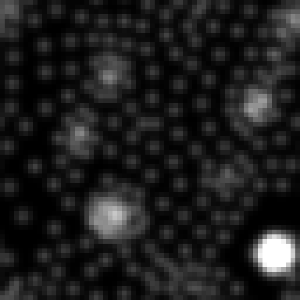
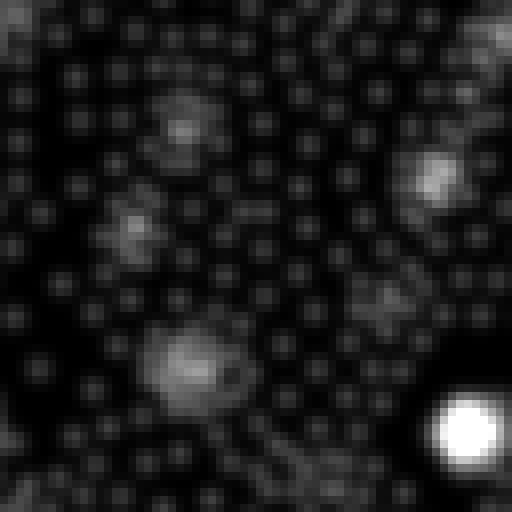
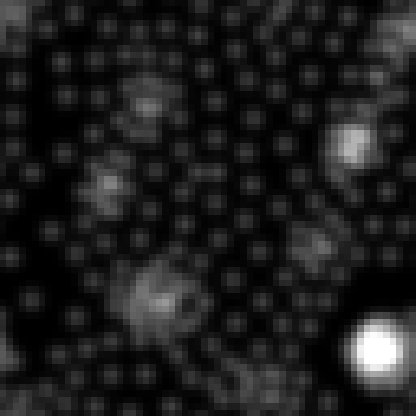
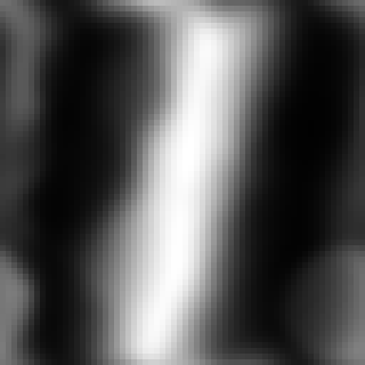
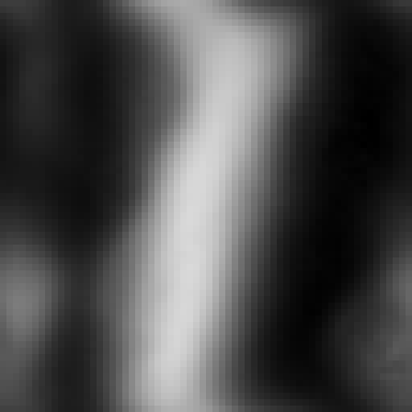

::: {.hero}
[]{.hero-pic style="-webkit-mask-image:url(banner.png);mask-image:url(banner.png)"}
[]{.hero-pic .hero-over style="-webkit-mask-image:url(banner-over.png);mask-image:url(banner-over.png)"}
:::

::::: {.split}

:::: {.split-left}

In epithelial colonies, waves of ERK activity, a signalling molecule, steer how the cells move.
Kikuchi et al. fitted a law that links each cell's acceleration to the ERK field and to the cell density around it [@kikuchi2025inverse].
This project asks the reverse question: can the ERK field be recovered from the cell positions alone, without telling the model how ERK and motion are related?

The data are synthetic.
Cell tracks were generated from the model of Kikuchi et al. in a periodic box.
Each frame was rendered as an image of blurred nuclei: every cell is a small blob of unit mass, so the image shows where cells are but carries no ERK signal.
A U-Net [@ronneberger2015unet], a convolutional network that maps one image to another, was trained to predict the ERK field from a short stack of these frames.

## Background reading

::: {#refs}
:::

::::

:::: {.split-right}

## Results

On a held-out sample the predicted field follows the true one closely (Pearson r = 0.96).
Three consecutive frames, spanning four minutes, work better than one frame or a long stack; the network appears to need the stack only to estimate how the cells are moving.

::: {layout-ncol=5}

:::

The three panels on the left are the network's entire input; the two on the right are the true ERK field at time t and the network's estimate. Both ERK panels share one grey scale.

The score is the masked R², the coefficient of determination computed only where cells are present.



Network: depth-3 U-Net with time stacked as input channels, 16/32/64/128 channels, group normalisation, circular padding to match the periodic box, trained on a masked mean squared error.

A field recovered this way is necessary for the observed motion, not sufficient to cause it; making a pattern happen is the subject of [Pattern Forcing](../gray-scott-inversion/index.qmd).

::::

:::::
