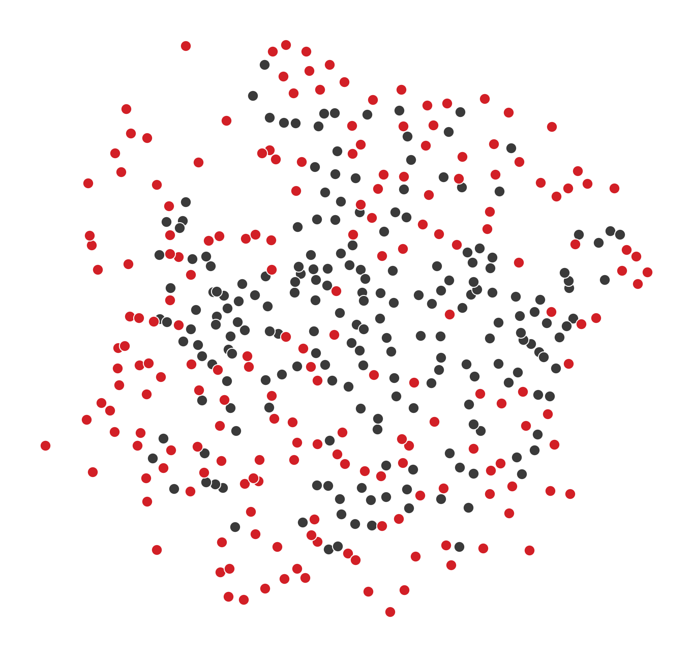
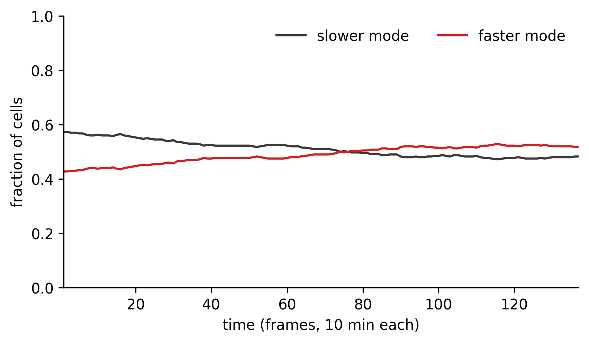

::: {.hero}
[]{.hero-pic style="-webkit-mask-image:url(banner.png);mask-image:url(banner.png)"}
:::

In migrating cell colonies some cells push the colony boundary outwards while others stay in place.
LaChance et al. found such behaviour modes by fitting one model to separate regions of a colony [@lachance2022learning].
This project asks whether cells can be sorted one by one instead of region by region, using only the positions of the cell centres.

Each cell is labelled at every time step by a hidden Markov model (HMM): a statistical model in which every cell is, at each moment, in one of a few hidden modes, and each mode has its own typical speed and turning [@langrock2012flexible].
The model is fitted with the expectation–maximisation algorithm [@dempster1977maximum], so it creates the modes and assigns the cells to them in the same pass.
Two modes were decoded for three colonies from the published trajectories of LaChance et al.: HUVEC, MDCK and MDA-MB-231 cells.

## Results

In HUVEC the two modes separate clearly.
The second mode sits mostly on the colony edge, moves faster and turns less than the first.
In MDCK the modes differ mainly in turning, not in position.
MDA-MB-231, a cancer line with reportedly little self-organisation, was included for reference; its small second mode differs only in speed and turning and may be an artefact of the data.

::: {layout-ncol=2}

:::

Neighbours are counted within three median nearest-cell distances.



There is no ground truth to score the labels against, so these modes are a description of the data, not a verified classification.

## Background reading

::: {#refs}
:::
