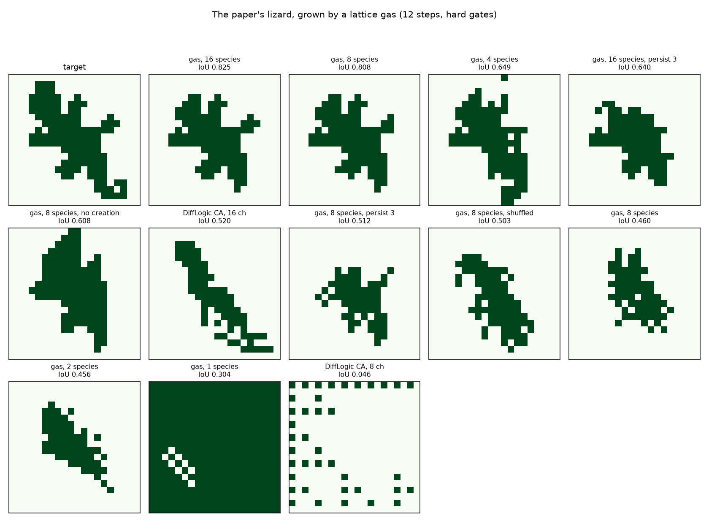

::: {.hero}
[]{.hero-pic style="-webkit-mask-image:url(banner.png);mask-image:url(banner.png)"}
:::

A cellular automaton updates every cell of a grid from its neighbours by one fixed rule.
Differentiable Logic Cellular Automata (DiffLogic CA) learn that rule as a circuit of logic gates [@miotti2025differentiable].
This project asks two things: can their figures be reproduced with less state per cell, and can such discrete rules learn a reaction–diffusion system, Gray-Scott, that is normally written as a PDE.

A second kind of automaton runs through the project: the lattice gas.
Each cell holds a few particles in channels, one per direction of motion; particles react inside the cell and then move to the neighbouring cells.
Moving particles carry information between cells, so the rule itself only has to look at one cell.

## Reproducing the paper with less state

The paper's Game of Life was reproduced exactly with 212 active gates, against the paper's 336.
The paper's weight decay was what kept it short of exact: with it, accuracy stalled at 96.5% even though the training loss was already zero.

For the paper's lizard (20 × 20, grown from one seed in 12 steps), the paper uses 128 bits of state per cell and 577 gates.
Replacing the paper's perception by lattice-gas transport grows the lizard with 40 bits per cell and about 200 gates.
On the same CPU budget, the logic-gate CA with 16 channels reached an IoU of 0.52; the gas reached 0.81 at 40 bits and 0.83 at 80.
The gas works only without the random shuffle of particles between channels: each channel then acts as a directed message, so a cell can tell its neighbours apart.



The grown lizards do not last: every run degrades by step 48.
Simple shapes are easier; a square and a disc reach IoU 1.00 from 16 species (80 bits) upward.

## Gas cellular automata

The gas follows Deutsch and Dormann: two species, an activator and an inhibitor, each with five channels per cell (four directions and rest).
In each cell the species with more particles wins and fills or empties both, then particles move; the inhibitor jumps farther, which gives long-range inhibition.
On a 64 × 64 grid this one rule makes checkerboards, fine labyrinths, spots or stripes, depending on the reaction probability and the jump lengths.

A logic-gate CA was trained to imitate the gas.
It learns the rule only when the reaction is deterministic; then its patterns match the gas exactly (same wavelength and occupancy).
With a random reaction it cannot learn to act on the random bit, and the patterns come out wrong or die.



Stable shapes can be designed in the averaged (mean-field) version of the gas: a circle and a diamond hold exactly, a ring holds when seeded, and a square always relaxes into a circle.
In the particle gas they are fragile.
With the random shuffle they fall apart (IoU 0.01–0.19); with a deterministic shuffle the circle is an exact fixed point, but updating only 90% of the cells per step destroys it, and so does raising the number of particles a cell can hold from 5 to 9.

## Learning Gray-Scott

**As a binary automaton.** Gray-Scott frames were thresholded to black and white, and the question was how well any rule could predict the next frame from a neighbourhood.
Accuracy is misleading here, because almost no cells change between steps; the honest score is change recall, the share of changing cells that are predicted.
From a 3 × 3 neighbourhood even the best possible rule predicts essentially none of them.
The neighbourhood a rule would need grows like the diffusion length, √(2 D t), about 6 cells when a frame is 100 solver steps apart.
Giving each cell 4 bits instead of 1 helped far more than widening the neighbourhood.



**As numbers in bits.** Writing each cell's concentrations as fixed-point numbers, a rule that reproduces Gray-Scott exists with about 12 bits per cell plus 4 random bits.
The logic-gate CA never learned it: it scored below simply copying the previous frame, since the rule needs multi-bit addition, multiplication and carries.

**As a lattice gas.** Posed as the gas above, the same physics becomes learnable (bit accuracy 0.94–0.96), but only with a deterministic reaction.
Gray-Scott itself written as a gas stays far from the PDE at the particle counts tried (8–32 per cell); matching it would need on the order of a thousand.

For contrast, a continuous automaton with real-valued cells recovers Gray-Scott's own coefficients almost exactly (reaction R² = 0.9998).
The obstacle is the discreteness, not the physics.

## Background reading

::: {#refs}
:::
